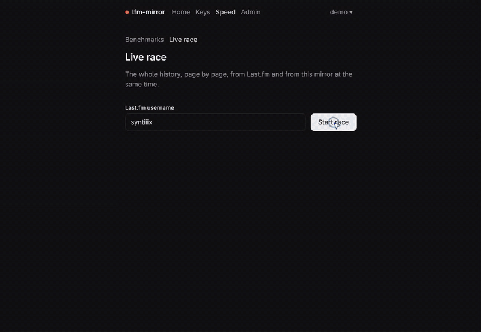

# fastfm

A self-hosted copy of the Last.fm API. It imports your scrobbles into SQLite, keeps them in sync,
and answers the same requests as `ws.audioscrobbler.com/2.0/`. Change the base URL and API key
in any Last.fm app, and your history comes back in milliseconds, with no rate limit.



Both sides fetch the same history, 200 scrobbles per request. After 20 seconds, Last.fm has sent
3,800 scrobbles in 16.8 s of request time. fastfm has sent 61,800 in 1 s, and what holds it back
is the browser drawing the list. Run the race yourself at `/demo/live` on your instance.

| Case | fastfm | Last.fm |
|---|---|---|
| Newest 500 scrobbles | 2 ms | 1.8–4.9 s |
| 20 mixed requests in a row | 73 ms | 30 s |
| Load test, 15 users, 1.78M scrobbles | 48,000–59,000 req/s | – |

## What it serves

- **Your listening data** (recent tracks, top lists, charts, loved tracks, library) comes from
  local data and matches Last.fm field for field.
- **Catalogue data** (artist and track info, tags, charts, search) is fetched from Last.fm once,
  then cached.
- **Scrobbles and loves** are saved locally, then forwarded to Last.fm.

It passes 381 of 420 recorded Last.fm responses. Most of the rest change on Last.fm between two
calls. See [docs/api.md](docs/api.md#limits-and-known-differences).

## Run it

You need a Last.fm API key and shared secret: <https://www.last.fm/api/account/create>.

```sh
docker run -d --name fastfm -p 3055:3055 -v fastfm-data:/data \
  -e LASTFM_API_KEYS=YOUR_KEY -e LASTFM_API_SECRET=YOUR_SECRET \
  ghcr.io/reazndev/fastfm
```

1. Open <http://localhost:3055/> and sign up. The first account becomes the admin.
2. Enter your Last.fm username on the home page. The import runs in the background.
3. Create a key under **API keys**, then point your app at `http://HOST:3055/2.0/`.

```sh
curl 'http://localhost:3055/2.0/?method=user.getRecentTracks&user=YOU&api_key=YOUR_KEY&format=json'
```

To serve it publicly, set `LFM_PUBLIC_URL`, `LFM_TRUST_PROXY` and `LFM_SETUP_TOKEN`. See
[docs/operations.md](docs/operations.md) for every setting, HTTPS, backups and upgrades.

## Docs

- [API reference](docs/api.md): every method, how it is served, auth, known differences
- [Operations](docs/operations.md): configuration, accounts, backups, reverse proxy
- [Contributing](CONTRIBUTING.md): development setup and checks
- [PLAN.md](PLAN.md): the design record

Last.fm's API terms apply to the data you store. A mirror of your own history is the intended
use. If you run an instance for other people, you are responsible for staying within the terms.

## Licence

`AGPL-3.0-or-later`, as declared in `Cargo.toml`. The repository has no `LICENSE` file yet.
